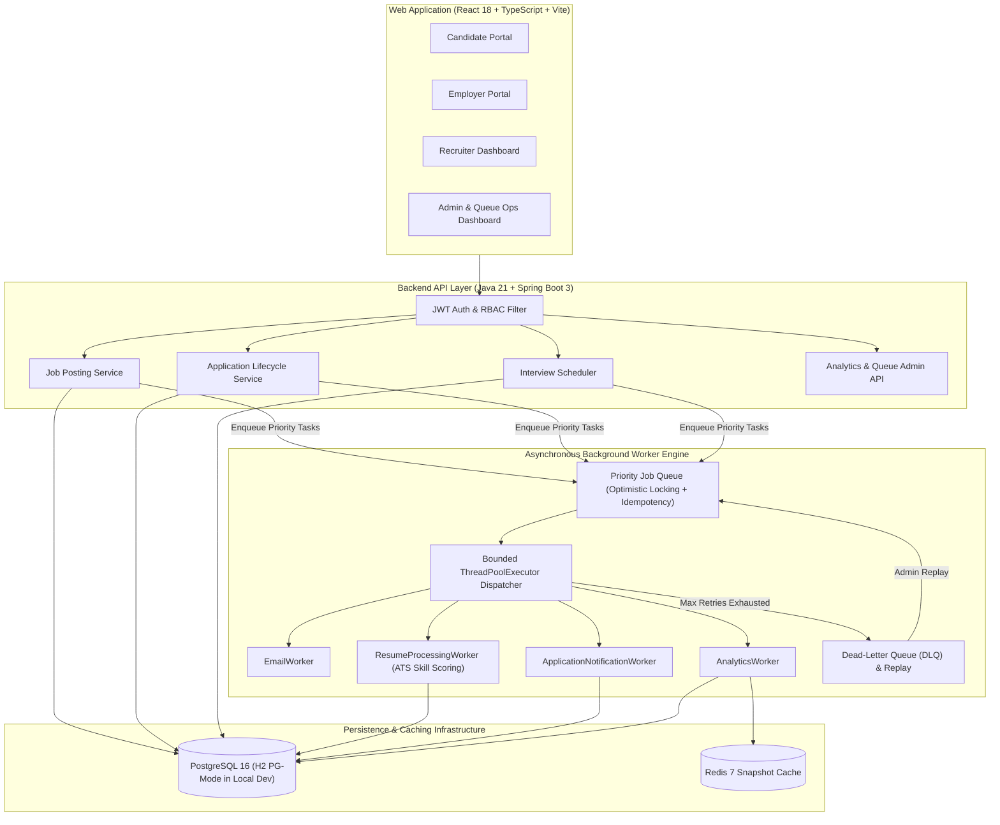
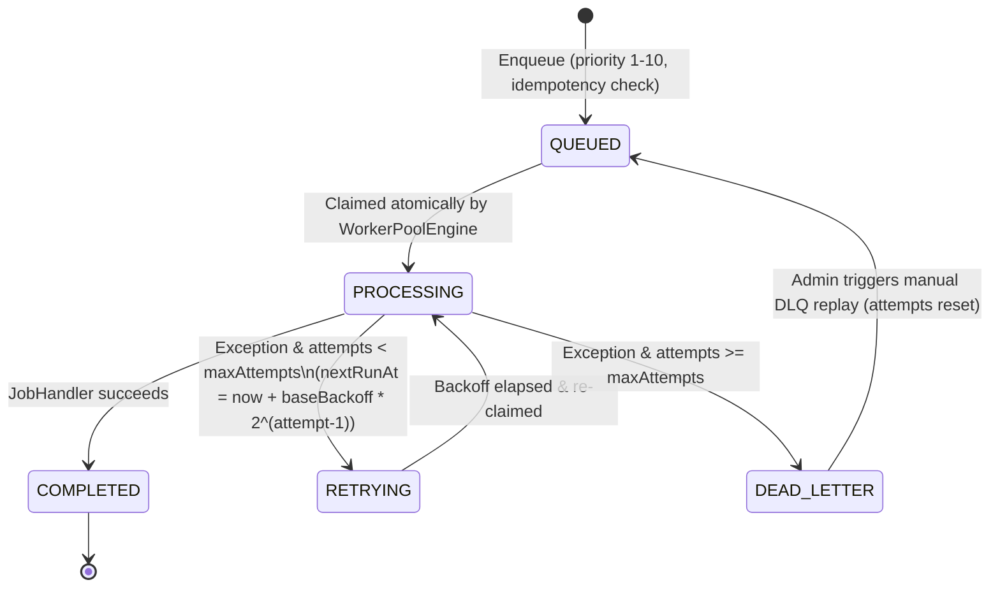

# System Architecture — Job Management System (JMS)

## High-Level Component Architecture

JMS bridges a **user-facing Applicant Tracking System (ATS)** with an **asynchronous priority background job processing engine** written in Java 21 / Spring Boot 3.

---

## Background Job Execution & Retry State Machine

Every asynchronous domain task (`PROCESS_RESUME`, `SEND_EMAIL`, `SEND_NOTIFICATION`, `REFRESH_ANALYTICS`) is stored durably in `background_jobs` with optimistic concurrency control (`@Version`), priority (`1–10`), optional `idempotencyKey`, and `nextRunAt` scheduling.

### Concurrency & Reliability Guarantees
1. **Priority-then-FIFO Ordering**: Eligible jobs (`status IN (QUEUED, RETRYING) AND next_run_at <= NOW()`) are claimed ordered by `priority DESC, created_at ASC`.
2. **Optimistic Claiming**: `@Version` prevents double-execution when multiple dispatcher cycles or worker nodes contend for the same row.
3. **Idempotent Enqueues**: Critical side-effects (e.g., welcome emails, application resume scoring) supply a unique `idempotencyKey` so duplicate triggers return the existing job safely.
4. **Exponential Backoff**: Failed attempts back off geometrically (`baseBackoffMs * 2^(attempt - 1)`), protecting downstream gateways (SMTP, external parsers) from retry storms.
5. **Dead-Letter Queue (DLQ) & Replay**: Jobs exhausting `maxAttempts` move to `DEAD_LETTER` with full error metadata and can be inspected and replayed via `POST /api/admin/queue/jobs/{id}/replay` or the Admin Queue UI.

---

## Event-Driven Application Pipeline

When a candidate submits an application (`POST /api/applications`), the HTTP request stays fast by persisting the application transactionally and fanning out **4 asynchronous priority jobs**:

1. **`PROCESS_RESUME` (Priority 9)**: `ResumeProcessingWorker` parses candidate resume/cover letter text against required skills, computes a 0–100% ATS score, records matched/missing skills, and fans out a high-match (`≥ 75%`) notification to the Employer.
2. **`SEND_NOTIFICATION` (Priority 7)**: `ApplicationNotificationWorker` persists an in-app alert for the Employer.
3. **`SEND_EMAIL` (Priority 6)**: `EmailWorker` dispatches an application confirmation email to the Candidate.
4. **`REFRESH_ANALYTICS` (Priority 3)**: `AnalyticsWorker` asynchronously recomputes system-wide hiring funnel metrics and refreshes the cache (in-memory + Redis in `prod` profile).
